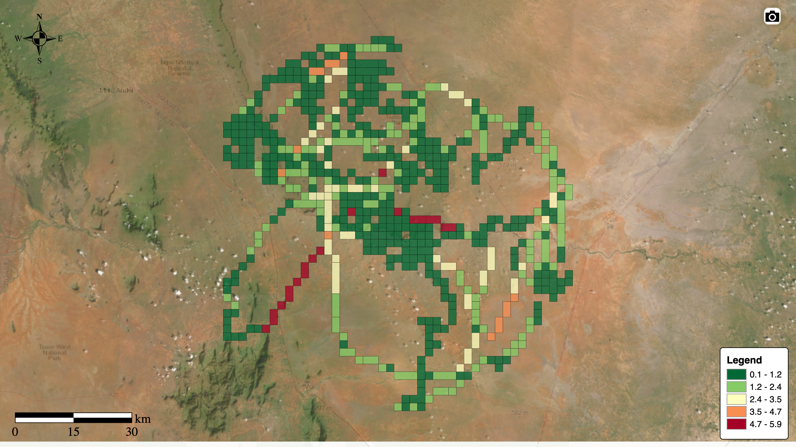

# Mean Speed Raster

Turns an EarthRanger subject group's GPS tracks into a grid of **mean movement speed**: each
grid cell holds the average speed (km/h) of the track segments that start in it. The cells are
sorted, binned into five equal-interval classes and coloured from green (slow) to red (fast) on an
interactive map — one view per subject, or one view for the whole group.



*Thumbnail made from a synthetic GPS track run through this workflow's own steps — not real animal data.*

## What it does

| # | Step | What it does |
|---|---|---|
| 1 | **Set Workflow Details** | Name and description shown on the dashboard. |
| 2 | **Set Time Range** | The period to analyse. |
| 3 | **Connect to Earthranger** | The EarthRanger data source to read from. |
| 4 | **Set Groupers** | "All" (one view) or one view per subject name. |
| 5 | **Subject Group** | Downloads the group's observations (cleaned fixes, with subject details). Fails if there are none. |
| 6 | **Set Base Maps** | Map tiles under the raster (topographic + 50% satellite by default). |
| 7 | **Process Relocs** | Drops fixes at known bad coordinates (0,0), (1,1) and (180,90) and keeps the columns used later. |
| 8 | **Trajectory Segment Filter** | Joins consecutive fixes into segments and removes segments outside the length / duration / speed limits. |
| 9 | **Add Temporal Index** | Indexes segments by their start time. |
| 10 | **Map Columns** | Renames the subject's name column to `subject_name` (the column the grouper uses). |
| 11 | **Split Groups** | Splits the segments into one table per view. |
| 12 | **Build Ecograph** | Lays a square grid over each view's tracks (cell size = Step Length) and averages segment speed per cell. |
| 13 | **Sort Ecograph Values** | Sorts cells by speed, lowest first, so the classes and colours come out in order. |
| 14 | **Apply Classification** | Bins speeds into 5 equal-interval classes labelled with their ranges (e.g. `0.1 - 1.2`). |
| 15 | **Apply Color Map** | Colours the classes with `RdYlGn_r`: green = slow, red = fast. |
| 16 | **Create Geojson Layer** | Draws the cells (55% opacity, thin black outlines, class shown on hover) with a legend. |
| 17 | **Compute View State From Gdf** | Centres and zooms each map on its cells. |
| 18 | **Persist Ecograph** | Saves each view's cells as GeoParquet. |
| 19 | **Create Files Single View** | Attaches each GeoParquet to its own dashboard view. |
| 20 | **Persist Relocations** | Saves all cleaned fixes as GeoParquet. |
| 21 | **Persist Trajectories** | Saves all filtered segments as GeoParquet. |
| 22 | **Pair up geo_layers, view_state by group** | Matches each view's layer with its map view. |
| 23 | **Draw Ecograph Map** | Renders each view's map as HTML (legend bottom-right). |
| 24 | **Persist Ecograph Map** | Saves each map HTML. |
| 25 | **Create Ecograph Widget Single View** | Makes a "Map" widget for each view. |
| 26 | **Merge Widget Views** | Combines them into one grouped "Map" widget. |
| 27 | **Gather Dashboard** | Builds the single dashboard: the map widget plus each view's GeoParquet. |

## Outputs

- **Dashboard** with one **Map** widget. With "Group by → Subject Name", a selector switches between subjects; each view has its own map and its own ecograph GeoParquet download.
- **Files** in the results folder (`ECOSCOPE_WORKFLOWS_RESULTS`):
  - one ecograph GeoParquet per view — columns `value` (mean speed, km/h) and polygon `geometry` in the tracks' UTM zone;
  - one map HTML per view;
  - the cleaned relocations and the filtered trajectories, each as one GeoParquet for the whole group.

## Requirements

- Access to an **EarthRanger** data source, set up as a connection.

---

## 1. Load the Workflow

In the workflow runner, add a new template using this repository's URL. Once added, select
**Mean Speed Raster** from the available templates list to load it.

---

## 2. Configure the Workflow

Fields marked *advanced* are hidden under the form's advanced options; their defaults work for most data.

### Set Workflow Details

| Field | Description | Default |
|---|---|---|
| Workflow Name *(required)* | Title shown on the dashboard. | — |
| Workflow Description | Shown under the title. | *(empty)* |

### Set Time Range

| Field | Description | Default |
|---|---|---|
| Since *(required)* | The start time. | — |
| Until *(required)* | The end time. | — |
| Timezone | Time zone for the dates above and the dashboard's time range. | — |

### Connect to Earthranger

| Field | Description | Default |
|---|---|---|
| Data Source *(required)* | One of your configured EarthRanger connections. | — |

### Set Groupers

| Field | Description | Default |
|---|---|---|
| Group by | Leave empty for a single **All** view of the whole group, or add **Category → Subject Name** for one view per subject. No other groupings are offered. | *(empty = All)* |

### Subject Group

| Field | Description | Default |
|---|---|---|
| Subject Group Name *(required)* | Picked from the chosen data source's subject groups. ⚠️ A group with mixed subtypes could give unexpected results. | — |

### Set Base Maps *(advanced)*

| Field | Description | Default |
|---|---|---|
| Base maps | Tile layers under the raster; the first is the bottom layer. | ArcGIS World Topo (100%) + World Imagery (50%) |

### Trajectory Segment Filter *(advanced)*

| Field | Description | Default |
|---|---|---|
| Minimum Segment Length (Meters) | Drop shorter segments. | `0.001` |
| Maximum Segment Length (Meters) | Drop longer segments. | `100000` |
| Minimum Segment Duration (Seconds) | Drop shorter segments. | `1` |
| Maximum Segment Duration (Seconds) | Drop longer segments (e.g. data gaps). | `172800` (48 h) |
| Minimum Segment Speed (Kilometers per Hour) | Drop slower segments. | `0.01` |
| Maximum Segment Speed (Kilometers per Hour) | Drop faster segments — lower it (e.g. to 9 for elephants) to remove GPS spikes. | `500` |

### Build Ecograph *(advanced)*

| Field | Description | Default |
|---|---|---|
| Step Length (m) | The size of each grid cell, in meters. Two choices: **Fixed value (m)** — you set it (must be between 500 and 100000); **Auto (use average step distance)** — the cell size becomes the average distance between consecutive GPS fixes. Smaller cells show more detail but take longer and leave more gaps. | Fixed value, `2000` |

---

## 3. Reading the map

- Each cell is coloured by its class; the legend lists the five speed ranges (km/h) from slowest (dark green) to fastest (red).
- Classes are **equal-interval** across the view's own speeds, so ranges differ between subjects — compare colours within one view, and read the legend before comparing views.
- Hover a cell to see its class.

---

## Developing

```bash
# recompile spec.yaml (first time: --install; after that: --update, which bumps VERSION.yaml)
./dev/recompile.sh --update

# run the test cases in test-cases.yaml
pixi run --manifest-path pixi.toml -e default bash dev/pytest-cli.sh mean_speed_raster --all
```

`--clobber` (used by `recompile.sh`) deletes `ecoscope-workflows-mean-speed-raster-workflow/`
including its `.pixi` environment; run `pixi install` in that folder afterwards before running
anything from it.

Documentation: [docs/index.html](docs/index.html) · technical details: [docs/technical-guide.html](docs/technical-guide.html).
