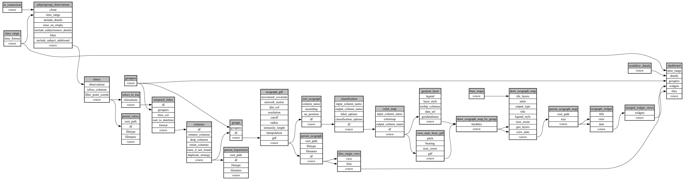

```
# AUTOGENERATED BY ECOSCOPE-WORKFLOWS; see fingerprint in README.md for details

```

```yaml
# fingerprint:
artifacts_sha256_basic: 53e86ca8b4fc5b465ec26c552ea5326ad33ed430352551b2572bec7568a1eac2
artifacts_sha256_strict: bd34bfc27a1d4640b40dc8a4d8bcc416d3eeaa939006ef0ec5af0a50ec0820af
installed_requirements:
- channel: https://repo.prefix.dev/ecoscope-workflows/
  name: ecoscope-platform
  version: {version: ==2.28.0}
- channel: conda-forge
  name: pydeck
  version: {version: ==0.9.2}
- channel: https://repo.prefix.dev/ecoscope-workflows-custom/
  name: ecoscope-workflows-ext-custom
  version: {version: ==0.1.4}
- channel: https://repo.prefix.dev/ecoscope-workflows-custom/
  name: ecoscope-workflows-ext-ste
  version: {version: ==0.0.34}
- channel: https://repo.prefix.dev/ecoscope-workflows-custom/
  name: ecoscope-workflows-ext-mnc
  version: {version: ==1.0.5}
params_sha256: 5685defada19e70ecb5ab4abcdb74562eb61073cb138a293e38405be87939f28
spec_sha256: 0f3297acdf818b2522a2ec2ecef549b99ba7ce7c3a1ddbdd8aa5c4a0061db627

```

# ecoscope-workflows-mean-speed-raster-workflow


